# Seed catalog

Published 2026-10-24 · 89 varieties · 75 with seed on hand · 29 plantings growing

## Amaryllidaceae — onion family

### *Allium cepa* — onion

- **Candy Hybrid Onion** — F1
  - Seed on hand: 2025
  - [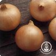](img/d109865e33bf7c17.jpg) Photo: [True Leaf Market](https://www.trueleafmarket.com/products/onion-candy-hybrid-seeds) (same name, another vendor's listing)
- **Texas Grano** — Urban Farmer · open-pollinated
  - Seed on hand: year not recorded · commercial · 250 seeds
  - Growing: growing, field, 2026
  -  Photo: [Urban Farmer](https://www.ufseeds.com/products/texas-early-grano-onion-seeds)

## Apiaceae — carrot family

### *Anethum graveolens* — dill

- **Bouquet** — Baker Creek Heirloom Seeds · open-pollinated
  - Seed on hand: year not recorded · commercial
  - [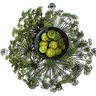](img/12e6985cb41dec5d.jpg) Photo: [Baker Creek Heirloom Seeds](https://www.rareseeds.com/dill-bouquet)

### *Daucus carota* — carrot

- **Rainbow Hybrid Carrot** — F1
  - Seed on hand: 2025
  - [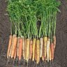](img/94e268d2b90ada74.jpg) Photo: [Park Seed](https://www.parkseed.com/collections/carrot/products/rainbow-hybrid-carrot-seeds-52407-pk-p1) (same name, another vendor's listing)

## Asteraceae — daisy family

### Cichorium (species not recorded) — chicory

- **Italian Amaro Blend** — Botanical Interests · open-pollinated
  - Seed on hand: year not recorded · commercial · 6 g
  - [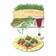](img/d97b8f363ce59458.jpg) Photo: [Botanical Interests](https://www.botanicalinterests.com/products/italian-amaro-blend-microgreens-seeds)

### *Helianthus annuus* — sunflower

- **Cinnamon Sun** — OP or hybrid not known
  - Growing: growing, field, 2026
  - [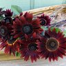](img/fd54e1705e391d0f.jpg) Photo: [Renee's Garden](https://www.reneesgarden.com/products/sunflower-cinnamon-sun) (same name, another vendor's listing)

### *Lactuca sativa* — lettuce

- **Landis Winter** — Baker Creek Heirloom Seeds · open-pollinated
  - Seed on hand: year not recorded · commercial
  - [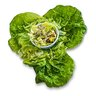](img/396c39a414da6e9e.jpg) Photo: [Baker Creek Heirloom Seeds](https://www.rareseeds.com/lettuce-landis-winter)
- **Little Gem** — open-pollinated
  - Seed on hand: 2025 · commercial
  - Growing: growing, indoor shelf, 2026; growing, indoor shelf, 2026; growing, field, 2026; growing, field, 2026
  - [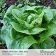](img/5c3ee49c2b45d045.jpg) Photo: [Botanical Interests](https://www.botanicalinterests.com/products/little-gem-mini-romaine-lettuce-seeds) (same name, another vendor's listing)
- **Lollo Rossa Lettuce** — open-pollinated
  - Seed on hand: 2025
  - [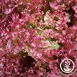](img/21a199732d1d5915.jpg) Photo: [True Leaf Market](https://www.trueleafmarket.com/products/lettuce-leaf-lolla-rossa-seeds) (same name, another vendor's listing)
- **Marvel of Four Seasons** — OP or hybrid not known
  - [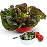](img/b1f8d022d9792961.jpg) Photo: [Baker Creek Heirloom Seeds](https://www.rareseeds.com/lettuce-merveille-des-quatre-saisons) (same name, another vendor's listing)
- **Parris Island Cos** — open-pollinated
  - Seed on hand: 2025
  - [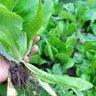](img/eb27dce72040f228.jpg) Photo: [Botanical Interests](https://www.botanicalinterests.com/products/parris-island-cos-romaine-lettuce-seeds) (same name, another vendor's listing)
- **Pint Sized Lettuce** — open-pollinated
  - Seed on hand: 2025
  - [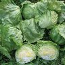](img/370aaf5fc8858647.jpg) Photo: [Johnny's Selected Seeds](https://www.johnnyseeds.com/vegetables/lettuce/iceberg-lettuce/pint-size-lettuce-seed-5232.html) (same name, another vendor's listing)

### Lactuca (species not recorded) — lettuce

- **Bon Vivant Mesclun Blend Lettuce** — open-pollinated
  - Seed on hand: 2025
  - [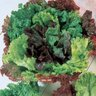](img/4bb5fa0bf7aeb467.jpg) Photo: [Reimer Seeds](https://www.reimerseeds.com/bon-vivant-premium-blend-lettuce-seeds) (same name, another vendor's listing)

### *Tagetes patula* — marigold

- **French Marigold** — open-pollinated
  - Growing: growing, field, 2026
  - [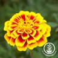](img/c01b20551b4ad038.jpg) Photo: [True Leaf Market](https://trueleafmarket.com/products/french-marigold-seeds-dainty-marietta) (generic photo)

## Boraginaceae — borage family

### *Borago officinalis* — borage

- **Borage** — open-pollinated
  - Seed on hand: year not recorded · commercial
  - [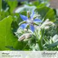](img/107a7f584ad4182c.jpg) Photo: [Botanical Interests](https://www.botanicalinterests.com/products/borage-seeds) (same name, another vendor's listing)

## Brassicaceae — mustard family

### *Brassica oleracea* — broccoli, broccolini

- **Ramoso Calabrese** — open-pollinated
  - Seed on hand: 2025
  -  Photo: [Sarah Raven](https://www.sarahraven.com/products/broccoli-ramoso) (same name, another vendor's listing)
- **Aspabroc** — Urban Farmer · F1
  - Seed on hand: year not recorded · commercial · 20 seeds
  - Growing: growing, field, 2026
  - [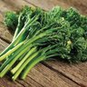](img/50daf6e96afc9ce7.jpg) Photo: [Urban Farmer](https://www.ufseeds.com/products/aspabroc-baby-f1-broccoli-seeds)

### *Raphanus sativus* — radish

- **Easter Egg Radish (spring)** — open-pollinated
  - Seed on hand: 2025
  -  Photo: [Botanical Interests](https://www.botanicalinterests.com/products/easter-egg-blend-radish-seeds) (same name, another vendor's listing)
- **Saxa 2** — Garden pack (EU) · open-pollinated
  - Seed on hand: year not recorded · commercial · 3 g; 2025
  - [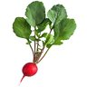](img/266f96422cb406fb.jpg) Photo: [Baker Creek Heirloom Seeds](https://www.rareseeds.com/radish-saxa-2) (same name, another vendor's listing)

## Cucurbitaceae — gourd family

### *Citrullus lanatus* — watermelon

- **Kurobe** — Baker Creek Heirloom Seeds · open-pollinated
  - Seed on hand: year not recorded · commercial
  - [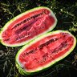](img/e5cec1784d26aa54.jpg) Photo: [Baker Creek Heirloom Seeds](https://www.rareseeds.com/watermelon-kurobe)
- **Moon and Stars** — Baker Creek Heirloom Seeds · open-pollinated
  - Seed on hand: year not recorded · commercial
  - [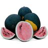](img/4a77d28933515d2d.jpg) Photo: [Baker Creek Heirloom Seeds](https://www.rareseeds.com/watermelon-moon-and-stars)

### *Cucumis melo* — melon

- **Honeydew** — open-pollinated
  - Seed on hand: 2026 · home-saved · Honeydew × Honeydew
  - [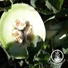](img/f8d727d8b15c25ec.jpg) Photo: [True Leaf Market](https://trueleafmarket.com/products/melon-honeydew-green-flesh-seeds) (same name, another vendor's listing)

### *Cucumis sativus* — cucumber

- **Cucumber** — OP or hybrid not known
  - Growing: growing, field, 2026
  - [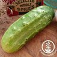](img/de06b0070ff32de4.jpg) Photo: [True Leaf Market](https://trueleafmarket.com/products/national-pickling-cucumber) (generic photo)
- **Pickling** — open-pollinated
  - Seed on hand: 2025 · commercial
  - [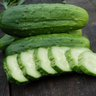](img/cc16a7690e9338f3.jpg) Photo: [Grow Organic](https://www.groworganic.com/products/national-pickling-cucumber-seeds-organic) (generic photo)

### *Cucurbita pepo* — pumpkin, squash

- **Connecticut Field** — Hudson Valley Seed Co. · open-pollinated
  - Seed on hand: year not recorded · commercial
  - [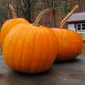](img/7a395ebf776b3d91.jpg) Photo: [Hudson Valley Seed Co.](https://hudsonvalleyseed.com/products/connecticut-field-pumpkin)
- **Delicata** — Urban Farmer · open-pollinated
  - Seed on hand: year not recorded · commercial · 20 seeds
  - [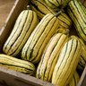](img/2045eea776dc9977.jpg) Photo: [Urban Farmer](https://www.ufseeds.com/products/delicata-squash-seeds)
- **Honeyboat Squash** — open-pollinated
  - Seed on hand: 2025
  - [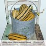](img/642b397493d1d0ff.jpg) Photo: [Botanical Interests](https://www.botanicalinterests.com/products/honey-boat-winter-delicata-squash-seeds) (same name, another vendor's listing)
- **Vegetable Spaghetti** — Urban Farmer · open-pollinated
  - Seed on hand: year not recorded · commercial · 30 seeds
  - [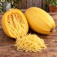](img/9d8e9068243f4af6.jpg) Photo: [Urban Farmer](https://www.ufseeds.com/products/vegetable-spaghetti-squash-seeds)

## Fabaceae — legume family

### *Cicer arietinum* — chickpea

- **Chickpea** — open-pollinated
  - [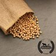](img/b37149986e632766.jpg) Photo: [True Leaf Market](https://trueleafmarket.com/products/garbanzo-bean-seeds-organic) (same name, another vendor's listing)

### *Glycine max* — soybean

- **Soybean** — open-pollinated
  - [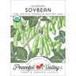](img/97a8fb81c2d5ca39.jpg) Photo: [Grow Organic](https://www.groworganic.com/products/edamame-soybean-seeds-organic) (same name, another vendor's listing)

### *Pachyrhizus erosus* — jicama

- **Jicama** — open-pollinated
  - Growing: growing, field, 2026
  - [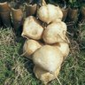](img/a8f4985b1830d165.jpg) Photo: [True Leaf Market](https://trueleafmarket.com/products/jicama-seeds-thai) (same name, another vendor's listing)

## Lamiaceae — mint family

### *Agastache foeniculum* — hyssop

- **Anise** — Baker Creek Heirloom Seeds · open-pollinated
  - Seed on hand: year not recorded · commercial
  - [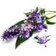](img/4c17c2231721528e.jpg) Photo: [Baker Creek Heirloom Seeds](https://www.rareseeds.com/agastache-anise-hyssop)

### *Melissa officinalis* — lemon balm

- **Limoncello** — Baker Creek Heirloom Seeds · open-pollinated
  - Seed on hand: year not recorded · commercial
  - [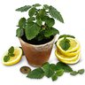](img/66a180b7435f9897.jpg) Photo: [Baker Creek Heirloom Seeds](https://www.rareseeds.com/lemon-balm-limoncello)
- **Mandarina** — Baker Creek Heirloom Seeds · open-pollinated
  - Seed on hand: year not recorded · commercial
  - [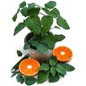](img/3e5573362d39dd13.jpg) Photo: [Baker Creek Heirloom Seeds](https://www.rareseeds.com/lemon-balm-mandarina)

### *Nepeta cataria* — catnip

- **Catnip** — open-pollinated
  - Seed on hand: 2025
  - [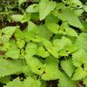](img/70fe3eeb7c991bfc.jpg) Photo: [Botanical Interests](https://www.botanicalinterests.com/products/catnip-seeds) (same name, another vendor's listing)

### *Ocimum basilicum* — basil

- **Genovese** — open-pollinated
  - Seed on hand: 2025
  - Growing: growing, indoor shelf, 2026; growing, field, 2026
  - [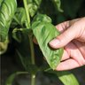](img/545ef61598409e3e.jpg) Photo: [Johnny's Selected Seeds](https://www.johnnyseeds.com/herbs/basil/genovese-basil/) (same name, another vendor's listing)
- **Thai** — OP or hybrid not known
  - Growing: growing, field, 2026
  - [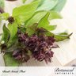](img/442149bc6c7f1b55.jpg) Photo: [Botanical Interests](https://www.botanicalinterests.com/products/sweet-thai-thai-basil-seeds) (same name, another vendor's listing)

### *Ocimum tenuiflorum* — basil

- **Holy (Tulsi)** — OP or hybrid not known
  - Growing: growing, field, 2026
  - [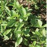](img/b9657eb193740016.jpg) Photo: [Johnny's Selected Seeds](https://www.johnnyseeds.com/herbs/basil/holy-basil/) (same name, another vendor's listing)

### *Origanum syriacum* — oregano

- **Wild Za'atar** — Baker Creek Heirloom Seeds · open-pollinated
  - Seed on hand: year not recorded · commercial
  - [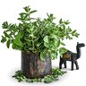](img/90fba3289c9f4557.jpg) Photo: [Baker Creek Heirloom Seeds](https://www.rareseeds.com/oregano-wild-za-atar)

### *Origanum vulgare* — oregano

- **Vulgare** — Baker Creek Heirloom Seeds · open-pollinated
  - Seed on hand: year not recorded · commercial
  - [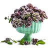](img/03876dccd92f55f8.jpg) Photo: [Baker Creek Heirloom Seeds](https://www.rareseeds.com/oregano-vulgare)

## Malvaceae — mallow family

### Mallow

- **Purple Mallow** — OP or hybrid not known
  - Growing: growing, field, 2026
  - [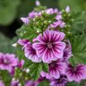](img/d02b827094224caa.jpg) Photo: [Romence Gardens](https://romencegardens.com/products/malva-sylvestris-zebrina) (generic photo)

## Poaceae — grass family

### *Zea mays* — corn

- **Blue Jade** — Hudson Valley Seed Co. · open-pollinated
  - Seed on hand: year not recorded · commercial
  - [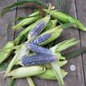](img/b77b900634d105b5.jpg) Photo: [Hudson Valley Seed Co.](https://hudsonvalleyseed.com/products/blue-jade-dwarf-sweet-corn)

## Polygonaceae — knotweed family

### *Rheum rhabarbarum* — rhubarb

- **Victoria** — Baker Creek Heirloom Seeds · open-pollinated
  - Seed on hand: year not recorded · commercial
  -  Photo: [Baker Creek Heirloom Seeds](https://www.rareseeds.com/rhubarb-seeds-victoria)

## Solanaceae — nightshade family

### *Capsicum annuum* — pepper

- **Ajvarski** — OP or hybrid not known
  - [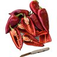](img/e5237afa22f401ec.jpg) Photo: [Baker Creek Heirloom Seeds](https://www.rareseeds.com/pepper-sweet-ajvarski) (same name, another vendor's listing)
- **Ancho Poblano** — Pepper Joe's · open-pollinated
  - Seed on hand: year not recorded · commercial · 50 seeds
  - [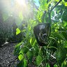](img/7c02cce7ada50e5c.jpg) Photo: [Pepper Joe's](https://pepperjoe.com/products/ancho-poblano)
- **CA Wonder Sweet Bell** — open-pollinated
  - Seed on hand: 2025
  - Growing: growing, field, 2026
  - [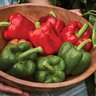](img/22cd7c2286d3c3a8.jpg) Photo: [Burpee](https://www.burpee.com/products/pepper-sweet-california-wonder-prod000825) (same name, another vendor's listing)
- **Chile De Arbol** — Pepper Joe's · open-pollinated
  - Seed on hand: year not recorded · commercial · 50 seeds
  - [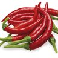](img/039cbe49a1b2c6c4.jpg) Photo: [Pepper Joe's](https://pepperjoe.com/products/chile-de-arbol-pepper-seeds)
- **Early Jalapeño** — open-pollinated
  - Seed on hand: 2025
  - Growing: growing, field, 2026
  - [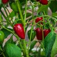](img/fa3504914b7b7233.jpg) Photo: [Pepper Joe's](https://pepperjoe.com/products/jalapeno-pepper-early) (same name, another vendor's listing)
- **Fresno** — Pepper Joe's · open-pollinated
  - Seed on hand: year not recorded · commercial · 10 seeds
  - [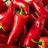](img/0b0a53718703209d.jpg) Photo: [Pepper Joe's](https://pepperjoe.com/products/fresno-pepper)
- **Hungarian Yellow Wax Hot Pepper** — open-pollinated
  - Seed on hand: 2025
  - [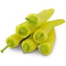](img/f1f4443fd452a971.jpg) Photo: [Baker Creek Heirloom Seeds](https://www.rareseeds.com/pepper-hot-hungarian-wax) (same name, another vendor's listing)
- **Jimmy Nardello's** — Pepper Joe's · open-pollinated
  - Seed on hand: year not recorded · commercial · 10 seeds
  - Growing: growing, field, 2026
  - [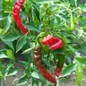](img/17017faffe09c991.jpg) Photo: [Pepper Joe's](https://pepperjoe.com/products/jimmy-nardellos-italian-pepper-seeds)
- **Lemon Spice Jalapeno** — Pepper Joe's · open-pollinated
  - Seed on hand: year not recorded · commercial · 10 seeds
  - [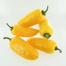](img/44b73ba0d3ab9a1d.jpg) Photo: [Pepper Joe's](https://pepperjoe.com/products/lemon-spice-jalapeno-pepper-seeds)
- **Mirasol** — Pepper Joe's · open-pollinated
  - Seed on hand: year not recorded · commercial · 50 seeds
  - [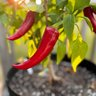](img/9394fdc8400b1223.jpg) Photo: [Pepper Joe's](https://pepperjoe.com/products/mirasol-pepper-seeds)
- **Nardello × open** — open-pollinated
  - Seed on hand: 2026 · home-saved · Jimmy Nardello's × unknown (fruit 1a)
  -  Photo: [Pepper Joe's](https://pepperjoe.com/products/jimmy-nardellos-italian-pepper-seeds) (generic photo)
- **NuMex Twilight** — Pepper Joe's · open-pollinated
  - Seed on hand: year not recorded · commercial · 10 seeds
  - [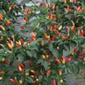](img/55cdc12a13c6b41b.jpg) Photo: [Pepper Joe's](https://pepperjoe.com/products/numex-twilight-pepper-seeds)
- **Padron** — Pepper Joe's · open-pollinated
  - Seed on hand: year not recorded · commercial · 10 seeds
  -  Photo: [Pepper Joe's](https://pepperjoe.com/products/padron-pepper-seeds)
- **Pasilla** — Pepper Joe's · open-pollinated
  - Seed on hand: year not recorded · commercial · 50 seeds
  - Growing: growing, field, 2026
  -  Photo: [Pepper Joe's](https://pepperjoe.com/products/pasilla-pepper-seeds)
- **Pepperoncini Greek Golden** — Pepper Joe's · open-pollinated
  - Seed on hand: year not recorded · commercial · 10 seeds
  -  Photo: [Pepper Joe's](https://pepperjoe.com/products/pepperoncini-greek-golden-pepper-seeds)
- **Royal Black** — Pepper Joe's · open-pollinated
  - Seed on hand: year not recorded · commercial · 10 seeds
  -  Photo: [Pepper Joe's](https://pepperjoe.com/products/royal-black-pepper-seeds)
- **Serrano** — Pepper Joe's · open-pollinated
  - Seed on hand: year not recorded · commercial · 50 seeds
  -  Photo: [Pepper Joe's](https://pepperjoe.com/products/serrano)
- **Thai Dragon** — OP or hybrid not known
  - Growing: growing, field, 2026
  -  Photo: [Pepper Joe's](https://pepperjoe.com/products/thai-dragon-f1-pepper-seeds) (same name, another vendor's listing)
- **Thai Hot** — Pepper Joe's · open-pollinated
  - Seed on hand: year not recorded · commercial · 10 seeds
  -  Photo: [Pepper Joe's](https://pepperjoe.com/products/thai-hot-pepper-seeds)
- **Tianjin** — OP or hybrid not known
  - Growing: growing, field, 2026
  -  Photo: [Trade Winds Fruit](https://www.tradewindsfruit.com/tien-tsin-pepper-seeds) (same name, another vendor's listing)

### *Capsicum baccatum* — pepper

- **Aji Amarillo** — Pepper Joe's · open-pollinated
  - Seed on hand: year not recorded · commercial · 10 seeds
  -  Photo: [Pepper Joe's](https://pepperjoe.com/products/aji-amarillo-pepper-seeds)
- **Aji Omnicolor** — Pepper Joe's · open-pollinated
  - Seed on hand: year not recorded · commercial · 10 seeds
  -  Photo: [Pepper Joe's](https://pepperjoe.com/products/aji-omnicolor-pepper-seeds)
- **Ají Lemon (Lemon Drop)** — open-pollinated
  - Seed on hand: 2026 · home-saved · Ají Lemon (Lemon Drop) × Ají Lemon (Lemon Drop)
  - Growing: growing, field, 2026
  -  Photo: [Pepper Joe's](https://pepperjoe.com/products/yellow-lemon-drop) (same name, another vendor's listing)

### *Capsicum chinense* — pepper

- **Bhut Jolokia (Ghost)** — open-pollinated
  - Seed on hand: 2026 · home-saved · Bhut Jolokia (Ghost) × Bhut Jolokia (Ghost); 2025
  - Growing: growing, field, 2026
  -  Photo: [Pepper Joe's](https://pepperjoe.com/products/ghost-pepper) (same name, another vendor's listing)
- **Devil's Tongue** — Urban Farmer · open-pollinated
  - Seed on hand: year not recorded · commercial · 10 seeds
  -  Photo: [Urban Farmer](https://www.ufseeds.com/products/devil-s-tongue-pepper-seeds)
- **Habanero** — OP or hybrid not known
  - Growing: growing, field, 2026
  -  Photo: [Burpee](https://www.burpee.com/products/pepper-hot-habanero-prod000805) (same name, another vendor's listing)

### *Capsicum pubescens* — pepper

- **Manzano Orange** — Pepper Joe's · open-pollinated
  - Seed on hand: year not recorded · commercial · 10 seeds
  - Growing: growing, indoor shelf, 2026
  -  Photo: [Pepper Joe's](https://pepperjoe.com/products/manzano-orange-pepper-seeds)

### *Physalis philadelphica* — tomatillo

- **Amarylla** — Baker Creek Heirloom Seeds · open-pollinated
  - Seed on hand: year not recorded · commercial
  -  Photo: [Baker Creek Heirloom Seeds](https://www.rareseeds.com/tomatillo-amarylla)
- **Chupon de Malinalco** — Baker Creek Heirloom Seeds · open-pollinated
  - Seed on hand: year not recorded · commercial
  -  Photo: [Baker Creek Heirloom Seeds](https://www.rareseeds.com/tomatillo-chupon-de-malinalco)
- **Purple Coban** — Baker Creek Heirloom Seeds · open-pollinated
  - Seed on hand: year not recorded · commercial
  -  Photo: [Baker Creek Heirloom Seeds](https://www.rareseeds.com/tomatillo-purple-coban)
- **Purple Tomatillo** — open-pollinated
  - Seed on hand: 2025
  - Growing: growing, field, 2026
  -  Photo: [Totally Tomatoes](https://www.totallytomato.com/product/T00869/115)
- **Rio Grande Verde Tomatillo** — open-pollinated
  - Seed on hand: 2025
  - Growing: growing, field, 2026
  -  Photo: [Baker Creek Heirloom Seeds](https://www.rareseeds.com/tomatillo-rio-grande-verde) (same name, another vendor's listing)

### *Solanum lycopersicum* — tomato

- **Amish Paste** — open-pollinated
  - Seed on hand: 2025
  - Growing: growing, field, 2026
  -  Photo: [Baker Creek Heirloom Seeds](https://www.rareseeds.com/tomato-amish-paste) (same name, another vendor's listing)
- **Beefsteak** — open-pollinated
  - Seed on hand: 2025
  -  Photo: [Burpee](https://www.burpee.com/products/tomato-beefsteak-organic-prod000962) (same name, another vendor's listing)
- **Burpee's Big Boy Hybrid** — F1
  - Seed on hand: 2025
  - Growing: growing, field, 2026
  -  Photo: [Burpee](https://www.burpee.com/tomato-burpees-big-boy-hybrid-prod000976.html)
- **Cherokee Purple** — open-pollinated
  - Seed on hand: 2025
  -  Photo: [Baker Creek Heirloom Seeds](https://www.rareseeds.com/store/vegetables/early-spring-favorites/cherokee-purple-tomato) (same name, another vendor's listing)
- **Darkstar** — F1
  - Seed on hand: 2026 · gift
  -  Photo: [Territorial Seed](https://territorialseed.com/products/darkstar) (same name, another vendor's listing)
- **Lg. Red Cherry** — open-pollinated
  - Seed on hand: 2025
  -  Photo: [Totally Tomatoes](https://www.totallytomato.com/product/T00424/124) (same name, another vendor's listing)

### *Solanum melongena* — eggplant

- **Black Beauty** — open-pollinated
  - Seed on hand: 2025
  -  Photo: [Burpee](https://www.burpee.com/products/eggplant-black-beauty-prod000706) (same name, another vendor's listing)
- **Long Purple** — open-pollinated
  - Seed on hand: 2025
  -  Photo: [Burpee](https://www.burpee.com/products/eggplant-long-purple-organic-prod000710) (same name, another vendor's listing)

## Tropaeolaceae — nasturtium family

### *Tropaeolum majus* — nasturtium

- **Cherry Rose Jewel** — Baker Creek Heirloom Seeds · open-pollinated
  - Seed on hand: year not recorded · commercial
  -  Photo: [Baker Creek Heirloom Seeds](https://www.rareseeds.com/nasturtium-cherry-rose-jewel)

## Family not recorded

### Wildflower mix

- **Butterfly Mix** — Theodore Payne Foundation · open-pollinated
  - Seed on hand: year not recorded · commercial
  -  Photo: [Theodore Payne Foundation](https://store.theodorepayne.org/products/butterfly-mix)
- **Coastal Mix** — Theodore Payne Foundation · open-pollinated
  - Seed on hand: year not recorded · commercial
  -  Photo: [Theodore Payne Foundation](https://store.theodorepayne.org/products/coastal-mix)
- **Golden Mixture** — Theodore Payne Foundation · open-pollinated
  - Seed on hand: year not recorded · commercial
  -  Photo: [Theodore Payne Foundation](https://store.theodorepayne.org/products/paynes-3-golden-mix)
- **Hummingbird Mix** — Theodore Payne Foundation · open-pollinated
  - Seed on hand: year not recorded · commercial
  -  Photo: [Theodore Payne Foundation](https://store.theodorepayne.org/products/hummingbird-mix)
- **Meadow Mix** — Theodore Payne Foundation · open-pollinated
  - Seed on hand: year not recorded · commercial
  -  Photo: [NativeSeed Group](https://nativeseedgroup.com/all-products/ca-coastal-native-wildflower-mix) (generic photo)
